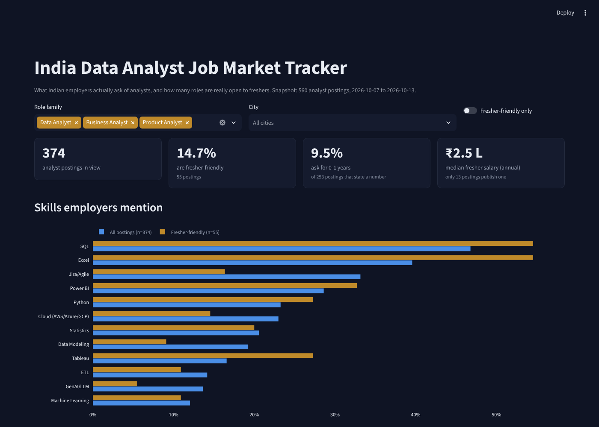

<h1 align="center">India Data Analyst Job Market Tracker</h1>
<p align="center"><b>How many "entry-level" analyst jobs in India are actually open to freshers? I pulled 1,000 postings and checked.</b></p>

<p align="center">
  
  
  
  
</p>

<p align="center"><a href="https://india-da-job-market-tracker-wg6vgx53vxkfefgzj9m2vz.streamlit.app/"></a></p>
<p align="center"><a href="https://india-da-job-market-tracker-wg6vgx53vxkfefgzj9m2vz.streamlit.app/"><b>▶ Open the live dashboard</b></a></p>



## Why I built this

I'm a fresher job-hunting for Data Analyst roles. Every job board says "thousands of openings", but most of them want 3-5 years.
Instead of guessing, I treated my own job search as a data problem: collect the postings, clean them, and measure what employers really ask for.

## Key findings (snapshot: 7–13 Oct 2026, 560 analyst postings)

| Question | Answer |
|---|---|
| How many postings are genuinely fresher-friendly? | **12.5%** (70 of 560) |
| How many ask for 0–1 years of experience? | **7.6%** of postings that state a number. The most common ask is **5–7 years (34%)** |
| Which big city is hardest for freshers? | **Pune: 1 fresher-friendly role out of 38 (2.6%)**. Mumbai (15.6%) and Chennai (11.6%) are the most open |
| What do fresher DA/BA roles ask for? | **SQL 55%, Excel 55%, Power BI 33%**, then Python and Tableau (27% each) |
| Power BI or Tableau? | **Power BI** – mentioned in 148 postings vs 95 for Tableau |
| SQL or Python? | SQL (270 postings) beats Python (179); **151 ask for both** |
| Is GenAI showing up in analyst JDs? | Yes: **21% of Data Analyst** postings mention LLMs/GenAI, vs 7% of Business Analyst and 42% of Data Scientist |
| What do freshers get paid? | Median **₹2.5 LPA** vs ₹5.4 LPA for experienced roles (only 71 postings publish a salary – treat as indicative) |

**What this means for a fresher:** SQL + Excel + Power BI is the core stack; Python is a differentiator, not the entry ticket. Apply wide across cities, and expect to compete for a small slice of the market.

## How it works

```
job listings (API)  ──►  src/extract.py  ──►  data/processed/jobs.csv  ──►  sql/insights.sql (DuckDB)  ──►  app.py (Streamlit)
  1,000 raw            regex: role family,        560 clean rows,             fresher flag, experience       interactive
  postings             seniority, years asked,    derived fields only         buckets, city & salary         dashboard
                       20 skills, salary (LPA)                                views
```

1. **Collect** – 1,000 India postings with analyst-type titles from a job-listings index (mostly LinkedIn-sourced).
2. **Clean & classify** (`src/extract.py`)
   - role family from the title (Data / Business / Product Analyst, Data Scientist, other analytics); finance-ops, QA, security, recruiting and trainer roles excluded
   - seniority from the title (senior is checked first, so "Senior Associate" isn't counted as junior)
   - experience = the **first** requirement stated in the JD (later mentions are often about the team, not the candidate)
   - 20 skills by keyword; salary normalised to annual lakhs (monthly × 12)
   - duplicates removed on title + company + city
3. **Analyse in SQL** (`sql/insights.sql`) – a `fresher_flag` view plus experience, city and salary views. Run `python src/analyze.py` to print every number above.
4. **Visualise** (`app.py`) – filter by role and city, compare skills for all vs fresher-friendly postings, browse and download the postings.

**"Fresher-friendly"** = not a senior title **and** (intern/junior title, **or** first stated requirement is 0–1 years, **or** the JD says fresher/entry-level and gives no number).

## Run it locally

```bash
pip install -r requirements.txt
streamlit run app.py              # dashboard
python src/analyze.py             # headline numbers in the terminal
```

## Limits (read before quoting the numbers)

- **One week** of postings, mostly LinkedIn-indexed – not every Indian job board.
- Skills are **keyword mentions** (required *or* preferred), not hard requirements.
- Only ~13% of postings publish a salary, so salary figures are indicative.
- Regex extraction was spot-checked against real JDs but is not perfect.
- Full job descriptions are **not** stored or republished – only derived fields and the original link.

## Roadmap

- [ ] Weekly refresh to show trends over time (is fresher demand rising or falling?)
- [ ] Add Naukri / Indeed sources
- [ ] LLM-assisted extraction for skills that keywords miss, checked against the regex baseline

---
<p align="center">Built by <a href="https://www.linkedin.com/in/suhas-1710d/">Suhas Dhamapurkar</a> · Data Analyst · open to roles across India</p>
